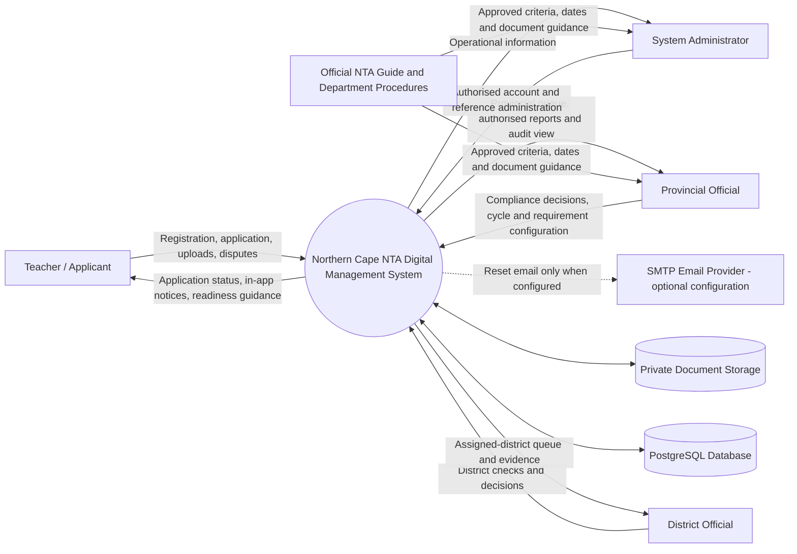
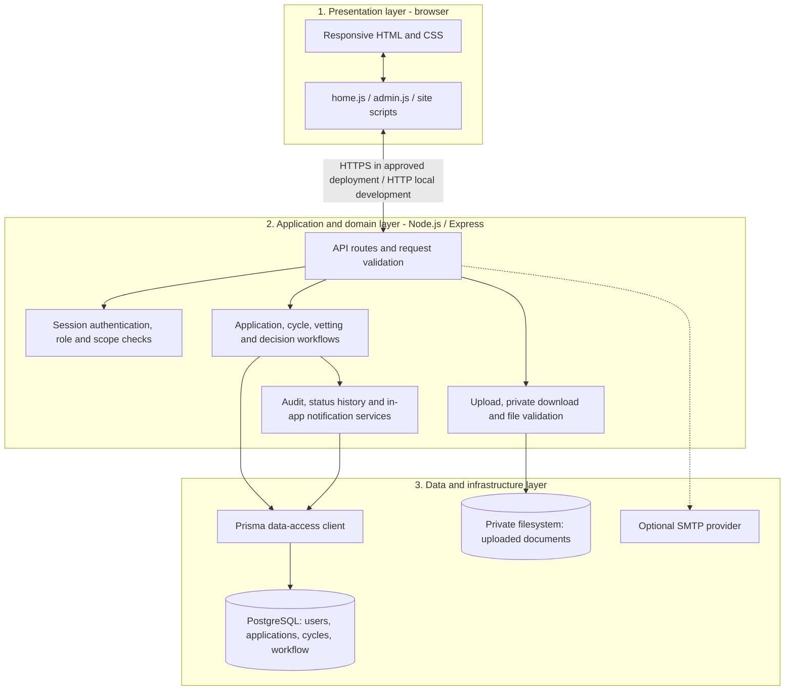
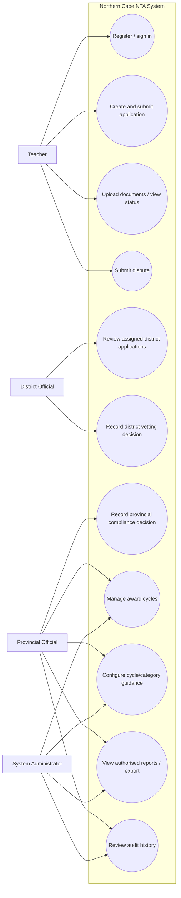
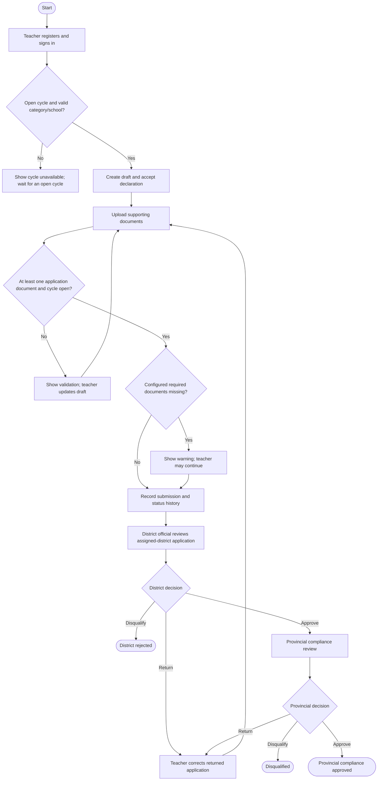
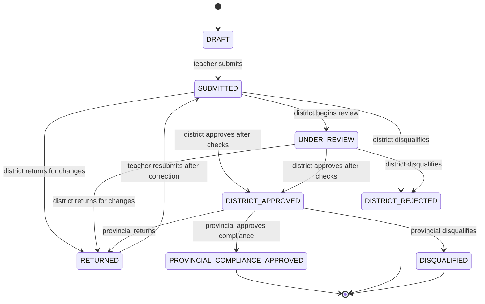
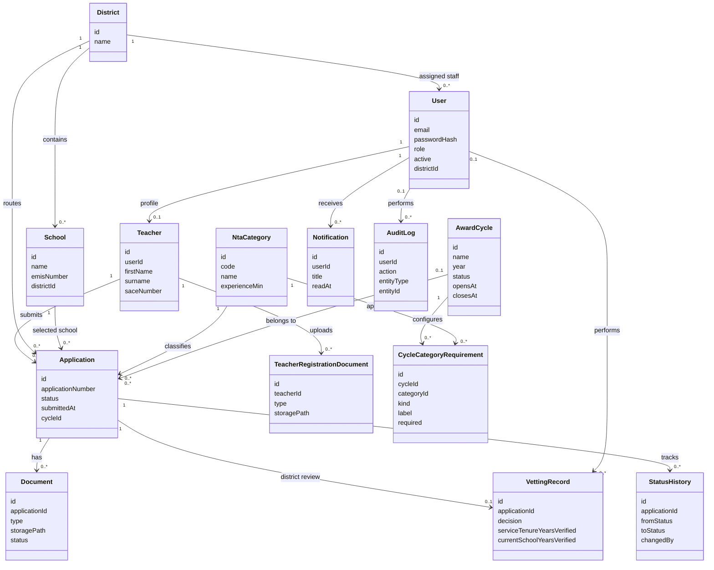

# Phase 2 Project Documentation

## Northern Cape National Teaching Awards Digital Management System

**School:** School of Natural and Applied Science  
**Department:** Computer Science and Information Technology (CSIT)  
**Project code:** NPRJ740 — 2026  
**Qualification:** Advanced ICT Diploma  
**Student:** Siphokuhle Njova  
**Organization:** Northern Cape Department of Education  
**Supervisor:** Dr Tite Tuyikeze  
**Submission date:** [To be completed]

> **Scope and evidence note:** This document describes the current project implementation and proposed quality targets. Where a requirement has not been measured or formally accepted, it is labelled proposed. Current development status is not evidence of production readiness. Refer to the Phase 1 report for the limited stakeholder interview evidence and the fieldwork still required.

## Contents

1. [Introduction and system scope](#1-introduction-and-system-scope)
2. [System requirements](#2-system-requirements)
3. [System modelling](#3-system-modelling)
4. [Project management](#4-project-management)
5. [Conclusion](#5-conclusion)
6. [References](#references)

## 1. Introduction and system scope

The Northern Cape National Teaching Awards Digital Management System is a role-based web application intended to support teacher registration and applications, private supporting-document handling, district vetting, provincial compliance decisions, cycle administration, and authorised reporting.

The application is implemented as a development project using Node.js, Express, PostgreSQL, Prisma, and a responsive HTML/CSS/JavaScript interface [1]. Its current documented capabilities and limitations are used to ground the requirements and models in this report. The system has not been certified or approved for operational use with real personal or confidential data. Award rules, approval authority, retention periods, and production service targets must be confirmed by the Department.

### 1.1 System boundary

The system manages application records and routes workflow decisions between users. It does not define official award policy, independently determine the correctness of submitted evidence, or replace authorised human review. Staff must configure cycle/category guidance from approved official sources. The configured teacher readiness checklist is advisory: missing configured items warn the teacher but do not by themselves prevent submission.

## 2. System requirements

### 2.1 Functional requirements — product features

| ID | Product feature / requirement | Primary actor | Current implementation / acceptance evidence |
|---|---|---|---|
| FR-01 | A teacher can register and sign in; credentials are stored as password hashes. | Teacher | Registration validates supplied fields and requires a privately stored SACE certificate. |
| FR-02 | Authorised staff can sign in using staff roles. | District, provincial, system administrator | Server routes enforce role checks; district accounts are assigned a district. |
| FR-03 | A teacher can create an application draft for an open award cycle, category, and school. | Teacher | Draft creation validates category, school, cycle, and declaration. |
| FR-04 | A teacher can upload application documents and view permitted application status/history. | Teacher | Uploads are privately stored; application document access is checked on the server. |
| FR-05 | A teacher can submit an eligible draft or returned application. | Teacher | Submission checks ownership, status, cycle dates, and the baseline supporting-document requirement. Configured missing required documents produce warnings. |
| FR-06 | A district official can view and vet applications assigned to that official’s district. | District official | District scope is checked by the server; approval requires completion of core checks and verified service-tenure values. |
| FR-07 | A district official can return, approve, or disqualify an application and record vetting notes. | District official | Decisions create status history, an audit event, and an in-app notification to the teacher. |
| FR-08 | Authorised provincial staff can record a compliance decision for district-approved applications. | Provincial official, system administrator | Supports approval, return, or disqualification and records the status history and audit event. Final provincial decisions do not currently send an automatic teacher notification. |
| FR-09 | Authorised staff can create award cycles, dates, and guide links. | Provincial official, system administrator | Cycle administration endpoints and interfaces are present. |
| FR-10 | Authorised staff can configure eligibility reminders and document requirements for a cycle/category pair. | Provincial official, system administrator | Configuration is saved per cycle and category; no policy rules are automatically seeded. |
| FR-11 | A teacher can see configured readiness information and warnings for missing configured documents. | Teacher | Warning-only behavior; it does not replace official checks or the baseline upload requirement. |
| FR-12 | Authorised users can access status history, notices, and dispute/reassessment workflows according to role. | Teacher and staff roles | Role-protected endpoints and application-level access checks are implemented. |
| FR-13 | Provincial officials/system administrators can export authorised provincial-approved applications and view audit history. | Provincial official, system administrator | CSV export is restricted to provincial-compliance-approved records and is audited. |
| FR-14 | A user can request a password reset using a time-limited, single-use token. | All account holders | Reset flow is implemented; email delivery depends on SMTP configuration. Passwords are never sent by email. |

### 2.2 Non-functional requirements

The targets below are **proposed acceptance targets**, not measured production results. A Department representative and supervisor should approve or replace them before formal acceptance testing.

| Quality attribute | Requirement / proposed acceptance target | Verification |
|---|---|---|
| Reliability | A failed request must show a useful error rather than a false success; key multi-record decisions should persist consistently. No data loss should occur during the agreed acceptance test cases. | Exercise failure paths, validation errors, and transaction/workflow tests; review server logs and persisted status history. |
| Availability | Proposed development/acceptance target: 99% availability during a defined one-month test window, excluding announced maintenance. Production target and support hours require Department approval. | Record monitored uptime and planned/unplanned downtime over the agreed window. |
| Security | Enforce server-side authentication, role checks, teacher ownership, and district scope; store password hashes; keep uploaded files outside the public static directory; validate file type and size; use HTTPS and strong secrets in production. No unauthorised test user may access another role’s or district’s protected data. | Role/ownership access-control test matrix; upload/download checks; deployment configuration and security review. |
| Privacy | Do not use real teacher data before formal approval. Minimise data collection, restrict access, and define consent, correction, retention, deletion, and breach processes with the Department. | Privacy and records-management review; test data inventory and access review. |
| Maintainability | Keep business rules in server-side validation, database structure in Prisma schema/migrations, and user interactions in documented client modules. Changes must pass syntax checks, Prisma validation, and relevant regression tests. | Peer review, `npm run check`, browser-script syntax checks, Prisma validation, and test records. |
| Portability | The app should run on a supported Windows development environment and a Department-approved Node.js/PostgreSQL host using documented environment configuration; no credential or machine-specific path should be required in source. | Reproduce setup in a clean environment from README instructions and `.env.example`. |
| Performance | Proposed target: 95% of ordinary page/API actions complete within 2 seconds at 50 concurrent test users on the agreed acceptance environment, excluding large uploads/report generation. This is an unmeasured target and must be adjusted to infrastructure. | Load test representative list, detail, and submission actions; report latency percentiles and environment. |
| Usability and accessibility | Key teacher and staff tasks should be completable with clear validation and status messages on desktop and mobile layouts; accessibility and supported browser requirements need agreement. | Task-based user acceptance and accessibility review with representative participants. |
| Auditability | Decisions and sensitive administrative actions must record actor, entity, action, and timestamp where supported; exports must be limited to authorised records. | Inspect audit and status-history records for each decision test. |
| Backup and recovery | Production deployment must have approved backup frequency, protected backup storage, and a demonstrated restoration procedure before live use. | Document and run a recovery drill; record recovery time and data-loss window. |

### 2.3 Constraints, assumptions, and external dependencies

- Official award criteria, required documents, dates, approval delegations, and retention rules must be verified against current Department of Basic Education guidance and departmental instructions [2].
- SMTP is an external dependency for password-reset email. Without delivery configuration, the system is not ready to provide production email reset.
- Hosting, HTTPS certificates, database operations, backups, monitoring, staff training, and helpdesk support require operational ownership.
- The project README identifies outstanding production-readiness items, including email verification, mandatory MFA, malware scanning, penetration testing, comprehensive automated testing, retention/restore drills, and fuller reporting [1].
- The submitted functional description is not an assertion that the Department has approved the workflow or accepted the prototype.

## 3. System modelling

### 3.1 Context diagram

The system is the central boundary. Actors provide data and actions; the system returns permitted statuses, decisions, notifications, and reports. The official guide is an external policy input used by authorised staff, not authored by the application. SMTP delivery is an optional external integration, not a currently guaranteed decision-notification channel.



### 3.2 Architectural design

The application follows a client/server model organised into three logical layers. A modular monolith is appropriate to the current project size: one Express application exposes the API and serves the browser client, while PostgreSQL and private filesystem storage hold persistent data and uploaded files.



#### Component responsibilities and interactions

1. **Presentation layer:** `public/index.html`, `public/admin.html`, shared CSS, and browser JavaScript present teacher and staff workflows, collect input, call API routes, and display server results. The client is not trusted to enforce access control.
2. **Application/domain layer:** `server.js` hosts Express routes, input validation, authentication/session middleware, role/district/ownership checks, application state transitions, upload handling, audit events, and notification creation.
3. **Data/infrastructure layer:** Prisma maps domain records in `prisma/schema.prisma` to PostgreSQL. Uploaded files are stored under the private upload directory, not served as ordinary public assets. Optional SMTP delivery requires external configuration.

### 3.3 Use-case diagram



### 3.4 Activity diagram — application review



### 3.5 State diagram — application

States follow the `ApplicationStatus` enum in the Prisma schema. `DRAFT` and `RETURNED` can be submitted; accepted transitions are also constrained by route validation. The separate `DISQUALIFIED` state represents a provincial disqualification; district rejection is `DISTRICT_REJECTED`.



### 3.6 Class diagram — principal domain classes

This is a high-level view of principal Prisma models and relationships, not a replacement for the complete database schema. Fields and multiplicities are abbreviated for readability [1].



### 3.7 Sequence diagram — submission and decisions

```mermaid
sequenceDiagram
  actor Teacher
  participant Browser
  participant API as Express API
  participant DB as PostgreSQL / Prisma
  actor District as District Official
  actor Provincial as Provincial Official

  Teacher->>Browser: Complete draft and choose submit
  Browser->>API: PATCH /api/applications/{id}/submit
  API->>DB: Load application, owner, documents, cycle, requirements
  DB-->>API: Application data
  API->>API: Validate owner, status, documents, cycle; calculate warnings
  API->>DB: Save SUBMITTED status and history
  API-->>Browser: Submission response and warning list
  Browser-->>Teacher: Show submitted status and warnings
  District->>Browser: Open assigned-district review queue
  Browser->>API: POST /api/applications/{id}/vetting
  API->>API: Enforce district scope and required approval checks
  API->>DB: Save vetting, status history, audit, in-app teacher notice
  API-->>Browser: District decision recorded
  Provincial->>Browser: Open district-approved application
  Browser->>API: POST /api/applications/{id}/provincial-decision
  API->>API: Require district-approved status and permitted decision
  API->>DB: Save provincial decision, status history and audit
  API-->>Browser: Provincial status response
  Note over API,Teacher: Final provincial decision does not currently create an automatic teacher notification.
```

## 4. Project management

### 4.1 Work breakdown structure and controls

The following work breakdown is a proposed plan for completing and evaluating the system. Each task includes its deliverable, milestone, resources, dependencies/constraints, and principal risk with contingency. Work packages are numbered for tracking; exact calendar dates and resource commitments must be agreed with the supervisor and project stakeholders.

| WBS | Task and description | Deliverable(s) | Milestone | Resources needed | Dependencies and constraints | Main risk and contingency |
|---|---|---|---|---|---|---|
| 1.0 | **Project initiation and stakeholder validation:** confirm scope, coordinator, user roles, fieldwork permissions, and current official process. | Approved scope; stakeholder list; verified process notes; fieldwork evidence log. | M1: process owner validates scope and process map. | Student; supervisor; coordinator; district/provincial representatives; approved interview/observation access. | Requires stakeholder availability and permission; do not collect real personal data unnecessarily. | Risk: limited access or incomplete recollection. Contingency: document the evidence limitation, schedule follow-up, and do not claim unverified facts. |
| 2.0 | **Requirements and policy analysis:** turn validated needs and current official guidance into functional, quality, privacy, and acceptance requirements. | Prioritised requirements catalogue; policy-source register; traceability matrix; agreed acceptance targets. | M2: requirements reviewed by supervisor and authorised process owner. | Student; coordinator; policy owner; official guide; Phase 1 findings. | Depends on 1.0; rules must not be inferred or invented. | Risk: policy ambiguity or changing rules. Contingency: record decision owner and version; leave unresolved rules configurable but inactive until approved. |
| 3.0 | **System and data design:** refine context, architecture, workflows, state model, class/data model, access matrix, and privacy/security design. | Reviewed diagrams; database design; role/access matrix; deployment and threat checklist. | M3: design review sign-off. | Student/developer; supervisor; database and security review support. | Depends on 2.0; design must align with implemented system and least privilege. | Risk: design diverges from policy or data model. Contingency: trace each design element to a requirement and review schema/API before implementation changes. |
| 4.0 | **Core implementation and integration:** implement/maintain registration, authentication, applications, uploads, district/provincial decisions, cycle requirements, notifications, and reports. | Working application increment; reviewed code; migration/configuration notes. | M4: end-to-end teacher-to-provincial workflow runs in a test environment. | Student/developer; Node.js; Express; PostgreSQL; Prisma; test environment; browser. | Depends on 3.0; existing service and schema; migrations must protect existing data and sessions. | Risk: regression or schema/data loss. Contingency: use versioned SQL migrations/backups in non-production test DB, targeted regression tests, and restore procedure. |
| 5.0 | **Verification and security testing:** validate routes, roles, district isolation, uploads, decision transitions, warnings, audit records, error handling, and performance. | Test plan and results; defect log; security/privacy checklist; performance measurements. | M5: critical test cases pass and blocking defects are resolved or formally accepted. | Student; seeded non-personal test data; test accounts; test browsers; reviewer/security support. | Depends on 4.0; no testing with live teacher records; measurable targets require an agreed environment. | Risk: insufficient test coverage or external security review unavailable. Contingency: disclose residual risk, use a test matrix, and prevent live deployment pending independent review. |
| 6.0 | **User acceptance, accessibility, and training:** conduct task-based tests with representative users and prepare role-specific guidance. | User acceptance results; accessibility findings; quick-start/training material; updated backlog. | M6: process owner accepts the test scope or records changes required. | Representative teachers and officials; coordinator; student; accessible test environment. | Depends on stable test build and approved participants; schedule/consent needed. | Risk: users unavailable or connectivity limitations. Contingency: record the limitation, arrange remote/alternative sessions, and do not claim user acceptance without evidence. |
| 7.0 | **Deployment and operational readiness:** define hosting, HTTPS, secrets, SMTP, database permissions, backups, restore, monitoring, support, retention, and incident response. | Deployment runbook; configuration checklist; restore-drill record; operational/privacy approvals. | M7: authorised readiness review completed before any live-data decision. | Approved hosting; database administrator; Department security/privacy/records owners; SMTP provider; backups. | Depends on 5.0 and 6.0; requires departmental approval, credentials, infrastructure, and policies. | Risk: missing operational owner or insecure configuration. Contingency: retain development-only status and block production data until controls and sign-offs exist. |
| 8.0 | **Documentation and academic submission:** finalise requirements, diagrams, test evidence, user material, project report, references, and presentation. | Phase 1/2 reports; traceability and test appendices; final presentation; submission package. | M8: supervisor-reviewed submission delivered. | Student; supervisor; source documents; verified evidence; project repository. | Depends on outputs from 1.0–7.0; submission date to be confirmed. | Risk: evidence/documentation incomplete near deadline. Contingency: maintain a checklist, clearly mark limits, and reserve review time before submission. |

### 4.2 Proposed Gantt chart

This is an **illustrative relative 12-week plan**, not a record of actual work dates or a confirmed academic calendar. Week 1 begins when the supervisor approves the schedule. Some tasks overlap to make efficient use of time; dependencies listed in the WBS remain controlling. Replace relative weeks with approved calendar dates before presenting this as the project baseline.

| WBS | Work package | W1 | W2 | W3 | W4 | W5 | W6 | W7 | W8 | W9 | W10 | W11 | W12 |
|---|---|---:|---:|---:|---:|---:|---:|---:|---:|---:|---:|---:|---:|
| 1.0 | Initiation and stakeholder validation | ■ | ■ | | | | | | | | | | |
| 2.0 | Requirements and policy analysis | | ■ | ■ | | | | | | | | | |
| 3.0 | System and data design | | | ■ | ■ | | | | | | | | |
| 4.0 | Core implementation and integration | | | | ■ | ■ | ■ | ■ | | | | | |
| 5.0 | Verification and security testing | | | | | | ■ | ■ | ■ | | | | |
| 6.0 | User acceptance, accessibility, training | | | | | | | | ■ | ■ | | | |
| 7.0 | Deployment/operational readiness review | | | | | | | | | ■ | ■ | | |
| 8.0 | Documentation and academic submission | ■ | | ■ | | | | | ■ | ■ | ■ | ■ | ■ |
| Milestones | M1 / M2 / M3 / M4 / M5 / M6 / M7 / M8 | ◆ | ◆ | ◆ | | ◆ | ◆ | | ◆ | ◆ | ◆ | | ◆ |

**Milestones:** M1 validated scope/process; M2 approved requirements; M3 design review; M4 integrated workflow; M5 verification gate; M6 user acceptance review; M7 operational readiness decision; M8 final academic submission.

### 4.3 Progress and change control

- Track each work package against its deliverables and milestone; record actual start/end dates after the schedule is approved.
- Maintain a requirements-to-design-to-test traceability table so each feature has an owner and verification method.
- Record policy decisions with the approving role and guide/version; do not silently change published cycle rules.
- Log risks, issues, and decisions with a responsible person and due date; escalate any privacy, access-control, or data-integrity issue before user testing.
- Baseline schedule changes should be reviewed with the supervisor, including their effect on dependencies, testing, and submission quality.

## 5. Conclusion

This Phase 2 specification translates the project’s documented workflows into functional and non-functional requirements and presents its context, layered architecture, use cases, application activity, state, principal classes, and submission/decision sequence. It also provides a work breakdown and relative Gantt schedule with deliverables, milestones, resources, dependencies, constraints, risks, and contingencies.

The requirements and diagrams describe the development build and proposed acceptance criteria; they are not evidence of production availability or formal Department acceptance. Before deployment or use of real teacher records, the Department must validate policy and role assignments, approve privacy and records controls, configure secure infrastructure and email, complete security and recovery testing, and formally accept the system.

## References

1. *Northern Cape National Teaching Awards Digital Management System*, project `README.md`, `docs/PROJECT_STRUCTURE.md`, `docs/REAL_DATA_POLICY.md`, and `prisma/schema.prisma`. Implementation capabilities and stated development limitations, accessed 6 November 2026.
2. Department of Basic Education / National Teaching Awards official guidance. Current applicable edition and formal departmental procedures were not supplied for this report; authorised policy owners must identify and cite them before the system is configured for operational use.
3. School of Natural and Applied Science, Department of Computer Science and Information Technology. *PROJECT NPRJ740 — 2026: Phase 2 Cover Page: Contents and Layout*. Assessment brief supplied by the student; defines the Phase 2 marking sections and criteria.
4. Njova, S. *Phase 1 Project Documentation: Northern Cape National Teaching Awards Digital Management System*. Project report draft, 2026.
